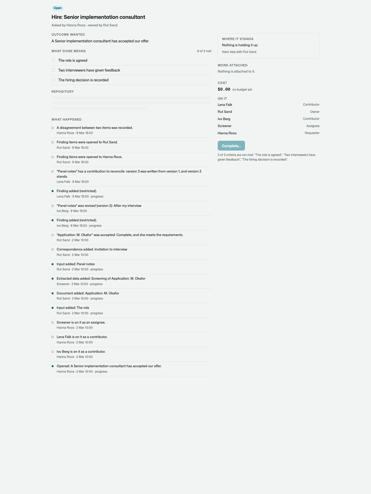
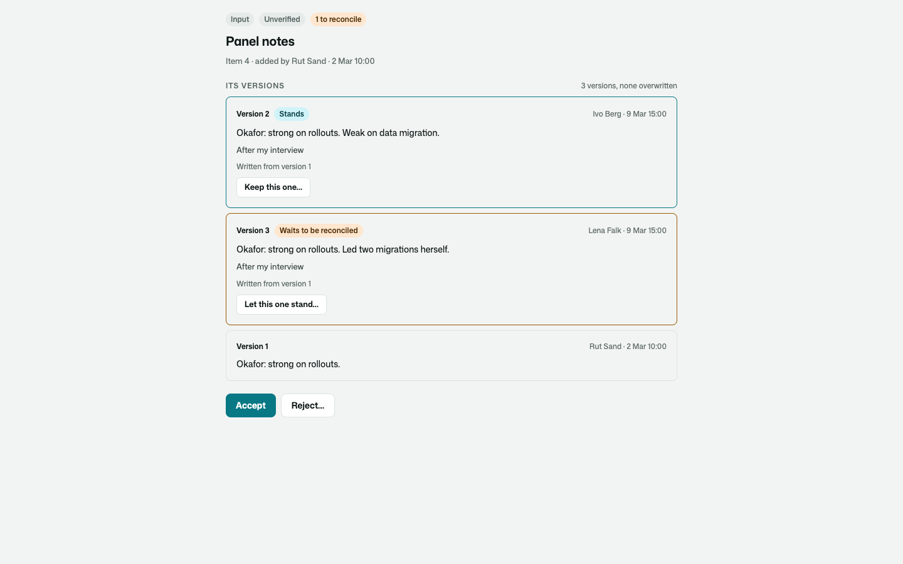
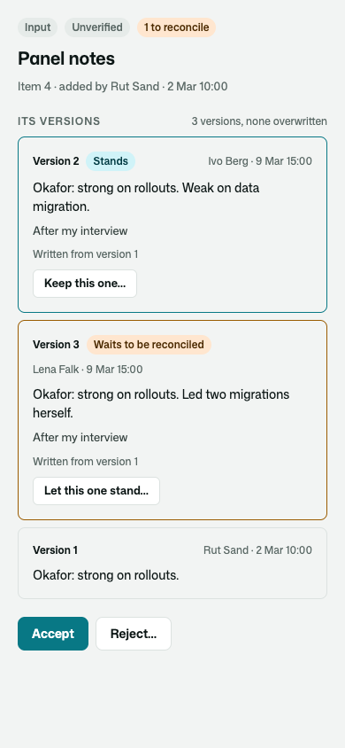

# Osysharp.WorkRepositories

What an assignment knows, kept as items: the evidence, the correspondence, the findings, the documents and the
decisions — each with who or what added it, when, and from where.

```osy
use Osysharp.WorkRepositories@1;

var scan = AddItem(a, new NewItem {
  Kind = ItemKind.Evidence, Title = "Carrier scan, 6 March",
  Content = "Parcel PL7731 scanned at the Malmö depot: damaged, held.",
  Source = new ItemSource { From = "The carrier's tracking page" },
});

ReviseItem(scan, new ItemRevision { Content = "…released on 9 March.", Note = "A second scan" }, basedOn: 1);
MeetWith(CriterionOf(a, "resolved"), scan, "The carrier's scan shows it delivered");
```



## Use case

Work that runs for days and passes through several hands leaves things behind: a scan, a letter, two people's notes
that do not agree, a decision somebody made on Tuesday. Kept in a comment thread or in an agent's trace, nobody can
say later what was known, who said it, or which version was acted on.

- **Nothing is overwritten.** Changing an item adds a version, and the version says who or what wrote it — a
  person, an agent's own account, or the app itself — and what it was read from.
- **Two contributors both stay.** Two people who started from the same version are both kept: the first stands, the
  second waits beside it, and the item says it has something to reconcile.
- **Kind and standing are two facts.** An item is an input, a document, extracted data, evidence, correspondence, a
  finding, a proposal, a decision or a deliverable — and it is unverified, accepted, rejected or superseded.
- **Disagreement stays visible.** Two items that contradict each other are linked until somebody in charge settles
  it with a decision.
- **One kind can be seen by fewer people.** Interview feedback is read by the interviewer and the hiring manager,
  not by the other interviewers.
- **One kind can be kept for less time.** Applications for six months after the hire closes; letters for thirty
  days.
- **A helper gets a reference, not a copy.** One item is opened to somebody who is not on the assignment, and
  closed again.



## What it does

| | |
|---|---|
| **Adding** | `AddItem(a, new NewItem { Kind, Title, Content, ContentType, DataJson, File, Key, Source, Restricted })`. Added again under its key, it is the same item, unchanged. Evidence, findings, decisions, documents and deliverables are progress on the assignment and point at the item. |
| **Changing** | `ReviseItem(item, new ItemRevision { Content, Note, Source, … }, basedOn)` adds a version. Based on the version that stands, it stands; based on an older one, it is kept beside it and `item.Unreconciled` counts it. |
| **Reconciling** | `ReconcileItem(item, keep, why)` chooses a version to stand; with `merged:` a new version that takes from several. Every version stays. |
| **Reading** | `ItemsOf(a, kind)` · `ItemOf(a, key)` · `CurrentOf(item)` · `VersionsOf(item)`. Each reader gets what they may read. |
| **Where it came from** | `ItemSource { From, Ref, RefType, Agent, Skill, SkillVersion, Model, Tool, Task }` on every version; `By` and `AddedAs` (`Person`, `Actor`, `System`) are read from who is acting, never taken from the caller. |
| **Standing** | `AcceptItem(item, why)` · `RejectItem(item, why)` · `QuestionItem(item, why)` — whoever is in charge of the assignment. `SupersedeItem(item, by)`. |
| **Meeting a criterion** | `MeetWith(criterion, item, metBy)` — the criterion points at the item. A rejected, superseded or erased item meets nothing. |
| **Disagreements** | `NoteDisagreement(first, second, about)` · `ResolveDisagreement(disagreement, decision, how)` — settled only by an item of kind `Decision`, by somebody in charge · `OpenDisagreements(a)`. |
| **Who sees what** | `KindRule { Kind, Restricted }` in the app's setting; `OpenKindTo(a, kind, person)` / `CloseKindTo`; `OpenItemTo(item, person)` / `CloseItemTo` for somebody on the assignment or not; `RestrictItem(item, restricted)`. |
| **How long it is kept** | `KindRule { RetainFor, From }` — from when it is added, or from when the assignment closes (reopening stops the clock). `ExpiredItems()` · `EraseItem(item, why)` · `EraseExpiredItems()` · `KeepItemUntil(item, until)`. Erasing empties every version — content, data, file, note and source — with why the item stands where it does, and takes its title out of the assignment's activity; the item stays to say there was one, what kind, who added it and when. |
| **A contributor who leaves** | `TakeContributorOffRepositories(person, why)`: what they added stays, word for word, as added by *Somebody no longer here*; what was opened to them is closed. With [`Osysharp.Privacy`](../privacy) in the app, [`Osysharp.Privacy.WorkRepositories`](../privacy-work-repositories) erases what is about a person who asks, and each kind when its own period ends. |
| **Events** | `RepositoryItemAdded`, `RepositoryItemContested`, `RepositoryItemAccepted`, `RepositoryItemRejected`, `RepositoryDisagreementRaised`, `RepositoryItemErased`. |
| **On a page** | `RepositoryList(assignment, open)` — and it arrives on every `AssignmentView` by itself. `RepositoryItemView(item)` is one item with every version; whoever is in charge accepts or rejects from it, and whoever works on the assignment says which version stands. |

## What the app says

```osy
app.WorkRepositories = new WorkRepositoriesSetup {
  ItemPath = "/items/",                                                             // where the app shows one item
  Kinds = [
    new KindRule { Kind = ItemKind.Finding, Restricted = true },                    // fewer people see it
    new KindRule { Kind = ItemKind.Document, RetainFor = TimeSpan.FromDays(180) },  // six months after the close
    new KindRule { Kind = ItemKind.Correspondence, RetainFor = TimeSpan.FromDays(30), From = RetainFrom.Added },
  ],
};

policy ManagesWorkRepositories => IsRecordsOfficer;   // reads every item, erases what has outlived its time
```

Whoever is on the assignment reads what is not restricted, and whoever works on it adds to it. A restricted item is
read by whoever added it and by whoever its kind, or the item itself, was opened to. A disagreement is read by
whoever may read both of the items it is about.



## What only the kit writes

| | |
|---|---|
| Two contributors update one item and neither is lost | `two_contributors_update_one_repository_item_and_neither_is_lost` |
| Changing an item adds a version and overwrites nothing | `changing_an_item_adds_a_version_and_overwrites_nothing` |
| What an actor and the app itself add says so | `what_an_actor_and_the_app_itself_add_says_so` |
| A restricted kind is read by whoever added it and whoever it was opened to | `a_restricted_kind_is_read_by_whoever_added_it_and_whoever_it_was_opened_to` |
| One item is opened to somebody outside the assignment, and nothing else is | `one_item_is_opened_to_somebody_who_is_not_on_the_assignment_and_nothing_else_is` |
| A disagreement about restricted items is read only by whoever reads both | `a_disagreement_about_restricted_items_is_read_only_by_whoever_reads_both` |
| A disagreement stays open until a decision settles it | `a_disagreement_stays_open_until_a_decision_settles_it` |
| Each kind is kept as long as the app says | `each_kind_is_kept_as_long_as_the_app_says` |
| Nothing of a repository is written except by the kit | `nothing_of_a_repository_is_written_except_by_the_kit` |

## Its tests

`kits/work-repositories/tests` is a company hiring a consultant: the role, the applications, a screener that notes
what each one says, two interviewers whose feedback does not agree, and a records officer. Suites for items and
their versions (`items`), who reads what and for how long (`access`), disagreements (`disagreements`) and the
pages (`ui`).

```
osy test kits/work-repositories/tests
```

## Source and package

- Package: `Osysharp.WorkRepositories` — `use Osysharp.WorkRepositories@1;`
- Source: [`kits/work-repositories`](.) — `model/Setup.osy` (kinds, standings, the app's rules), `Items.osy` (items
  and versions), `Standing.osy` (standing, criteria, disagreements), `Access.osy` (who sees what, retention,
  erasing), `Events.osy`, `ui/` (the sheets and the views).
- Uses [`Osysharp.Assignments`](../assignments), `Osysharp.Identity`, `Osysharp.Storage` (a version may be a file)
  and `Osysharp.Ui`.
- With it: [`Osysharp.WorkRepositories.Agents`](../work-repositories-agents) lands an agent's findings as items.

## Examples

Taken from this package's own tests, which compile and run on every release.

```osy
using Osysharp.Identity;
using Osysharp.Assignments;
using Osysharp.WorkRepositories;
using Hiring;

[Test(Office)]
void a_repository_is_read_by_whoever_is_on_the_assignment_and_by_nobody_else() {
  var hire = OpenTheHire();
  runas (Rut) { AddItem(Hire(hire), new NewItem { Kind = ItemKind.Input, Title = "The role", Content = "Senior consultant." }); }
  runas (Ivo) {
    Assert.Equal(1, ItemsOf(Hire(hire)).Count);
    Assert.Equal("Senior consultant.", CurrentOf(ItemsOf(Hire(hire))[0]).Content);
  }
  // Pia interviews for other hires. She is not on this one: nothing of its repository is hers to read.
  runas (Pia) {
    Assert.Equal(0, RepositoryItem.Count());
    Assert.Equal(0, RepositoryItemVersion.Count());
    Assert.Equal(0, Assignment.Count());
  }
}
```

From [`tests/access.test.osy`](tests/access.test.osy).

```osy
using Osysharp.Identity;
using Osysharp.Assignments;
using Osysharp.WorkRepositories;
using Hiring;

[Test(Office)]
void a_disagreement_about_restricted_items_is_read_only_by_whoever_reads_both() {
  var hire = OpenTheHire();
  Guid ivos = Guid.Empty;
  Guid lenas = Guid.Empty;
  runas (Ivo) { ivos = GiveFeedback(Hire(hire), "M. Okafor", "Could not explain a cutover plan.").Id; }
  runas (Lena) { lenas = GiveFeedback(Hire(hire), "M. Okafor", "Walked through a cutover plan.").Id; }
  runas (Rut) { OpenKindTo(Hire(hire), ItemKind.Finding, Hanna); }
  runas (Hanna) { NoteDisagreement(Item(ivos), Item(lenas), "Whether the candidate can plan a cutover"); }

  // The hiring manager was given the feedback: she reads that the two disagree, and about what.
  runas (Hanna) { Assert.Equal("Whether the candidate can plan a cutover", OpenDisagreements(Hire(hire)).Single().About); }
  // Each interviewer reads their own feedback and not the other's — so neither reads the disagreement, whose
  // subject alone would tell them what the other thought.
  runas (Ivo) {
    Assert.Equal(0, RepositoryDisagreement.Count());
    Assert.Equal(0, OpenDisagreements(Hire(hire)).Count);
    Assert.False(ActivityOf(Hire(hire)).Any(l => l.Said.Contains("cutover")));
    Assert.Contains("A disagreement between two items was recorded.", ActivityOf(Hire(hire)).Select(l => l.Said).ToList());
  }
  runas (Lena) { Assert.Equal(0, RepositoryDisagreement.Count()); }
  // The recruiter oversees every hire, and was not given the feedback either.
  runas (Rut) { Assert.Equal(0, RepositoryDisagreement.Count()); }
  // Opened to everybody on the hire, both items — and the disagreement — are everybody's to read.
  runas (Hanna) { RestrictItem(Item(ivos), false); RestrictItem(Item(lenas), false); }
  runas (Ivo) { Assert.Equal(1, OpenDisagreements(Hire(hire)).Count); }
}
```

From [`tests/disagreements.test.osy`](tests/disagreements.test.osy).

```osy
using Osysharp.Identity;
using Osysharp.Assignments;
using Osysharp.WorkRepositories;
using Hiring;

[Test(Office)]
void whoever_is_in_charge_erases_an_item_and_only_the_records_officer_erases_from_the_activity() {
  var hire = OpenTheHire();
  Guid cv = Guid.Empty;
  runas (Rut) { cv = AddItem(Hire(hire), new NewItem { Kind = ItemKind.Document, Title = "Application: S. Lind", Content = "Six years." }).Id; }
  // Rut owns the hire: she erases the item. She may not erase from an assignment's activity, so the line that named
  // the application stands until somebody who may takes it out.
  runas (Rut) { EraseItem(Item(cv), "Sent to us by mistake."); }
  Background.Settle();
  runas (Rut) {
    Assert.Equal("", CurrentOf(Item(cv)).Content);
    Assert.Contains("Application: S. Lind", ActivityText(Hire(hire)));
    Assert.Denied(() => EraseWordsFromActivity(Hire(hire), ["Application: S. Lind"], "an item that was erased", "Tidying up."));
  }
  runas (Otto) { Assert.Equal(1, EraseWordsFromActivity(Hire(hire), ["Application: S. Lind"], "an item that was erased", "The item it named was erased.")); }
  runas (Rut) { Assert.DoesNotContain("Lind", ActivityText(Hire(hire))); }
}
```

From [`tests/erasure.test.osy`](tests/erasure.test.osy).

## Learn more

- [The Osysharp.WorkRepositories reference](https://osysharp.com/reference/agent/kit-work-repositories/)
- [Osysharp.WorkRepositories in the package catalogue](https://osysharp.com/packages/#osysharp-workrepositories)
- [The Osy# reference](https://osysharp.com/reference/) — the language, the runtime and every kit
- [`llms-full.txt`](https://osysharp.com/llms-full.txt) — the whole reference and specification as one Markdown file, for a coding agent

## Licence

MIT — see [`LICENSE`](LICENSE).
